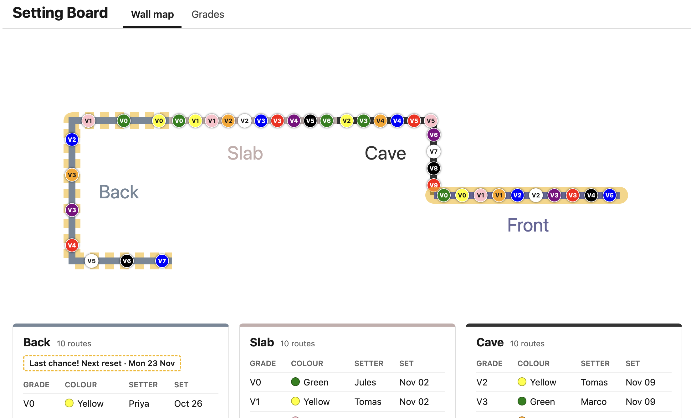
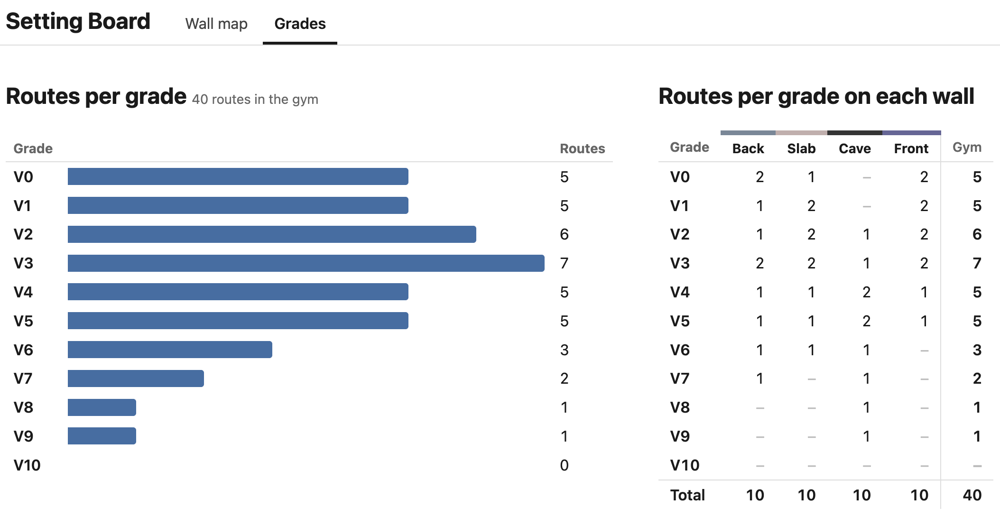

# Setting Board

A Rails app for a climbing gym's route setting team. It shows the gym's wall map, every route on each wall, which wall is reset this week and next, and how many routes there are at each grade.

**Stack:** Rails 8, MySQL, server-rendered SVG, Minitest, and GitHub Actions CI running linting and security scans.





## The problem

Each week a climbing gym strips one wall and sets new routes on it. Head setters need to see what's on every wall, keep a sensible grade mix (most routes at V2–V4, the fewest at V9–V10), and plan which wall is next. Usually resets happen on the same day each week, but they can move for events and get skipped for holidays.

## What it does

- **Wall map:** the four wall sections drawn as an SVG floor plan. Each route is a marker in its hold colour, labelled with its grade.
- **Route lists:** one card per wall, listing grade, colour, setter and set date.
- **Reset schedule:** the wall reset this week is highlighted solid and the next upcoming reset is dashed. The date appears on the wall's card, so a reset moved to a Tuesday shows as Tuesday.
- **Grade distribution:** a Grades tab with a bar chart of how many routes there are at each grade across the gym, next to a grade × wall table with totals. Grades with no routes show as a muted dash, so gaps in the mix stand out.

## Other design decisions

- **No front-end build step.** The map is plain SVG rendered on the server. Markers are spaced evenly along each wall's path, with a gap at the ends so markers on walls that meet at a corner don't overlap (`FloorPlan::Wall#marker_positions`).
- **Routes are retired, never deleted.** When a wall is reset, `WallSection#reset!` stamps its routes with `retired_on` and records the date the reset really happened, in one transaction. History is stored rather than calculated from the schedule, so moving a planned reset never rewrites the past, and `Route.on(date)` gives the routes up on any day.
- **Rules enforced by the database too.** Foreign keys, NOT NULL columns, unique indexes and check constraints (grades V0–V10, no route retired before it was set) back up the model validations, and tests insert bad rows directly to prove the database rejects them.
- **Repeatable seeds.** `db:seed` is idempotent: it never duplicates or overwrites routes or resets, and CI runs it on every push. The seeds include a past rotation of retired routes, so there's history to query.

## Quality checks

CI runs on every push and pull request. It runs RuboCop, Brakeman, bundler-audit, an importmap audit, the model, controller and system tests, and the seeds. Dependabot keeps gems and GitHub Actions up to date.

## Run it

Requires Ruby 3.4.13 and MySQL on `127.0.0.1` (default `root` user, no password; see `config/database.yml`).

```bash
bin/setup    # installs gems, sets up and seeds the database, starts the server
bin/ci       # runs the same checks as CI
```

Then open http://localhost:3000.

## Next steps

It's read-only for now, with no sign-in or forms. In priority order:

1. **Compare the grade distribution with a target mix**, so the Grades tab shows which grades are over- or under-set.
2. **Forms and authentication**, so setters can add routes, record resets, and plan, move and skip them. Today resets are recorded in the console with `WallSection#reset!`.
3. **Grade mix over time** on the Grades tab, using the stored route history.
4. **Route positions on each wall**, to flag a repeated grade on the same stretch of wall.
5. **Climber sends**, to compare how often each setter's routes get climbed.
6. **Deploy** with the included Kamal setup.
