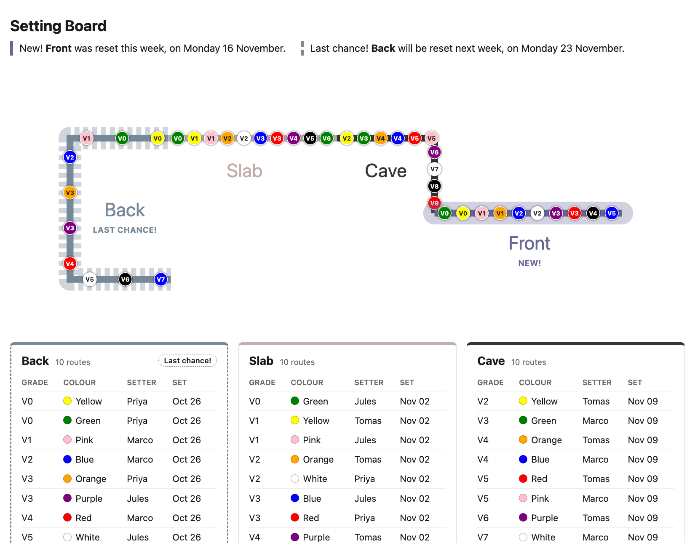

# Setting Board

A web app for a climbing gym's route-setting team. It shows the gym's wall map, every route on each wall, and which wall is being reset this week and next. Built with Rails 8, MySQL and server-rendered SVG, with security scans and tests running in CI.



## What head setters need

One wall is stripped and reset every Monday, in a fixed order. Each week, head setters balance:

- **A grade mix for everyone.** Most climbers fall in V2-V4, so most routes belong there. Plenty of V0-V1, a few V7-V8, and the fewest at V9-V10.
- **Variety.** No repeated grade on the same wall space within a section, and something new for everyone on the freshly reset wall.
- **Learning from setter style.** Each route records its setter, so the team can see whose sets get climbed most and whether style and popularity correlate.

## What it does today

- **Wall map**: the four wall sections (Back, Slab, Cave, Front) as a floor plan, with each route as a marker coloured by hold colour and labelled with its grade.
- **Route lists**: one card per wall with grade, colour, setter and set date.
- **Reset schedule**: highlights the wall reset this week (solid) and the one due next week (dashed), calculated from the calendar so nobody has to update it.

It records the inputs for the goals above (grade, wall, setter, date) but doesn't measure them yet; that's the first item under next steps.

## Design decisions

- **Reset rotation defined once.** Wall sections have fixed ids (Back 1, Slab 2, Cave 3, Front 4) and the weekly rotation follows them. The logic lives on the `WallSection` model, shared by the page and the seeds, with tests for week boundaries and the wrap-around.
- **Setters are their own table.** Routes reference a setter by id. The migration carried existing data across, is reversible, and was tested by rolling back and re-applying it.
- **No front-end build step.** The map is plain SVG generated by the server, and markers space themselves along each wall.
- **Repeatable seeds.** `db:seed` never duplicates or overwrites routes. The sample data is illustrative and not yet tuned to the target grade mix.

## Run it

Requires Ruby 3.4 and MySQL on `127.0.0.1` (default `root` user, no password; see `config/database.yml`).

```bash
bin/setup    # installs gems, sets up and seeds the database, starts the server
bin/ci       # RuboCop, security audits, Brakeman, tests, seeds
```

Then open http://localhost:3000.

## Next steps

This is an early, read-only app: no sign-in or forms yet.

- Grade distribution for the whole gym and per wall, compared against the target mix
- Record each route's position on its wall to flag repeated grades
- Let climbers mark routes they've sent, to compare setters' climb counts
- Forms and authentication for setters to add and retire routes
- Make the reset rotation configurable, and deploy with the included Kamal setup
